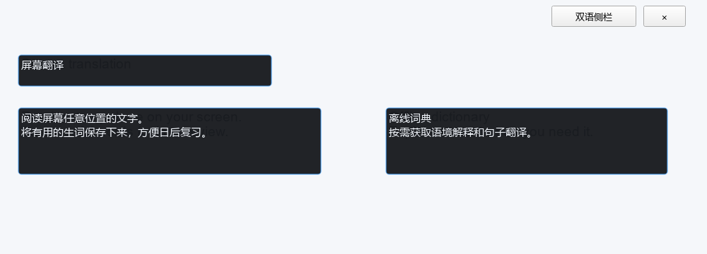
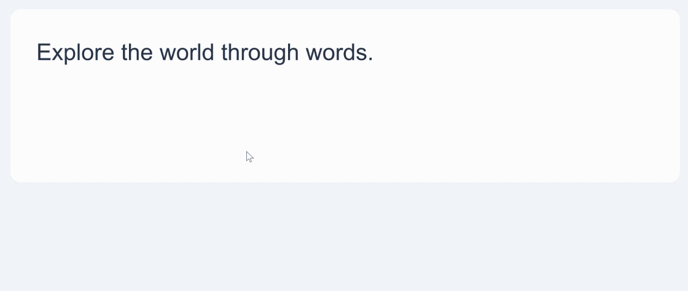
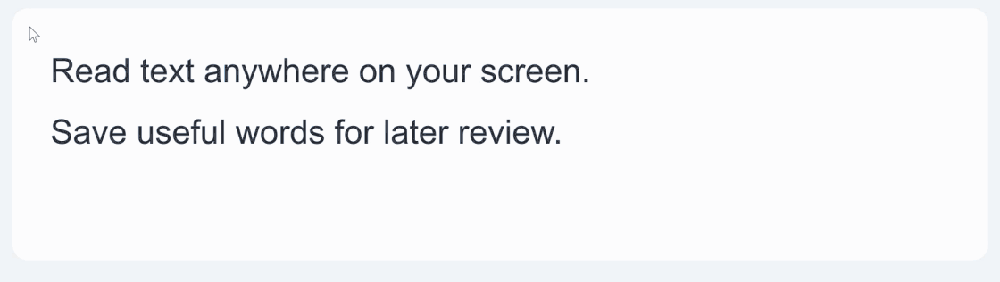
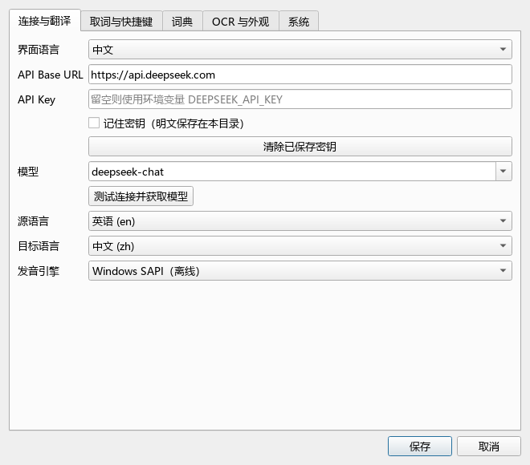
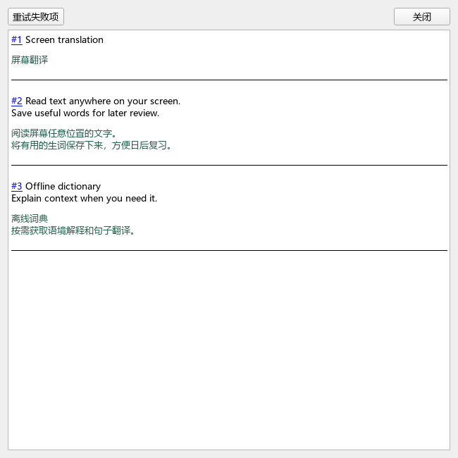
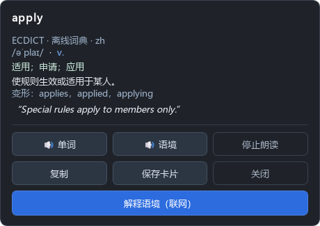

# ScreenGloss

**English** | [简体中文](README.zh-CN.md)

A Windows screen translator, pointer dictionary, and word-card tool. OCR and offline dictionary lookup run locally; translation and context explanations use your configured API.



This repository contains source code. Install the dependencies before running it; dictionaries and Japanese, Korean, and Russian OCR models can be added separately.

## Features

- Select a screen region, recognize text locally, and translate it in batches with overlays and a bilingual panel.
- Look up words with a hotkey or mouse hover. Choose offline-first, model-first, offline-only, or model-only lookup.
- Request a word's contextual meaning and sentence translation when needed.
- Translate clipboard text; save, search, and edit word cards; export Anki TSV.
- Use offline Windows SAPI speech or optional online Edge-TTS.
- Configure API connections, hotkeys, OCR, caching, and redacted diagnostics.
- Run in the system tray, with optional desktop shortcuts and startup integration.

## Demos

Click an animated preview to open the original MP4. The two recordings demonstrate the model dictionary and screen translation using synthetic text, with no audio track. The examples translate English into Chinese.

### Pointer dictionary - Alt+D

Point at `world`, open its model-generated definition, and optionally request a context explanation.

[](docs/demos/dictionary.mp4)

[Open / download the original video (13 seconds)](docs/demos/dictionary.mp4)

### Screen translation - Alt+S

Select two English sentences and display their Chinese translation near the original text.

[](docs/demos/screen.mp4)

[Open / download the original video (10 seconds)](docs/demos/screen.mp4)

## Install and run

Requires Windows 10/11 x64 and Python 3.11. At least 8 GB of RAM is recommended. OCR uses the CPU by default; CUDA is not required.

Open PowerShell in the repository root:

```powershell
py -3.11 -m venv .venv
.\.venv\Scripts\python.exe -m pip install -r requirements.txt
.\.venv\Scripts\python.exe -B app\launcher.py
```

After installation, double-click `run.bat`, or use `run-console.bat` for troubleshooting. The application runs in the system tray. Double-click its tray icon to open settings, or use the right-click menu to exit.

The interface defaults to English on first launch. In the first settings tab, use **Interface language** to select Chinese or another language and save. Existing saved language choices are preserved. The demos and screenshots show the Chinese interface.

If `py` is unavailable, use the full path to an installed Python 3.11 `python.exe` to run `-m venv .venv`.

`requirements.lock` pins the core packages and their dependencies. The UI uses Qt Essentials. Run the application from its project directory.

### Offline resources

The RapidOCR package supplies the default Chinese/English detection and recognition models. Additional Japanese, Korean, and Russian recognizers, StarDict dictionaries, and JMdict data must be prepared separately; cloning the repository does not install them.

See [offline resources](resources/README.md) for paths and verification. Model lookup can be used without local dictionaries. Offline-only lookup requires an installed dictionary. Large StarDict dictionaries build a local disk index on first use.

## Translation API



In Settings > Connection and translation, enter the Base URL, API key, and model. The default endpoint is `https://api.deepseek.com`. OpenAI Chat Completions-compatible endpoints are supported; the model must return complete JSON output.

The connection test checks generation with the selected model and attempts to fetch the model list. It sends a small amount of synthetic text.

API keys can be supplied in three ways:

- **Session only:** enter a key in settings without selecting Remember key.
- **Environment:** set `DEEPSEEK_API_KEY` or `OPENAI_API_KEY`.
- **Local storage:** explicitly select Remember key to store it in plaintext in the Git-ignored `data/config.json`.

Priority is session key, saved key, then environment. Routine settings saves do not copy environment credentials into the configuration file. The [example configuration](config.example.json) contains no credentials and is not loaded automatically.

The API timeout covers one request and its network retries. Long text may require multiple requests. Cancellation stops local waiting, but a request already received by the server may continue there.

## Hotkeys and translation

| Default hotkey | Action |
|---|---|
| `Alt+S` | Freeze the screen and select a translation region |
| `Alt+D` | Look up the word at the pointer |
| `Alt+T` | Translate clipboard text |
| `Alt+H` | Toggle hover lookup |
| `Esc` | Close the focused selection layer, overlay, dictionary card, or bilingual panel |

Hotkeys are configurable. A new operation replaces the previous task. Closing an overlay cancels that screen-translation task; late results cannot reopen it. Use the bilingual panel for long translations, cross-screen blocks, or layout conflicts. Failed items can be retried separately.



## Dictionary, word cards, and speech



OCR supplies word positions, and the application extracts nearby sentence context locally. Explain context is an explicit online action. Offline-only mode does not call the model. Offline definitions retain their dictionary's language rather than being automatically translated into the target language.

Word cards support search, editing, deletion, and export of selected or all records. Saving the same word, source/target languages, and sentence updates the existing card; different contexts remain separate. Anki TSV uses UTF-8 and Front / Back / Tags fields. Enable HTML when importing. Images, audio, and `.apkg` packages are not generated.

Speech defaults to SAPI, with language coverage determined by installed Windows voices. To use online Edge-TTS, install the optional dependencies and select it in settings:

```powershell
.\.venv\Scripts\python.exe -m pip install -r requirements-tts.txt
```

Edge-TTS sends the text to an online service and attempts to fall back to system speech on failure.

## Data and privacy

- `data/` is created at runtime for settings, word cards, caches, dictionaries, indexes, logs, and temporary audio. Git ignores the entire directory.
- OCR and offline lookup do not upload screen images. Model features send the relevant text to the configured endpoint.
- Translation caches and word cards may contain personal text. Do not upload them or include them in release packages.
- There is no telemetry or automatic diagnostic upload. Logs do not normally contain keys, screen text, headwords, or complete service responses.
- Debug screenshots are disabled by default. Enabling them retains the latest 10 OCR input images. A screenshot save failure does not interrupt OCR.
- Diagnostics and cache in the tray menu can check resources, clear caches, and export redacted diagnostics. Export does not upload anything.
- Desktop shortcuts and startup integration are opt-in. Recreate enabled shortcuts after moving the project.

## Checks and limitations

Offline tests use temporary settings, databases, and synthetic text rather than personal word cards:

```powershell
.\.venv\Scripts\python.exe -B tools\run_checks.py
```

Results go to the Git-ignored `tests/artifacts/`. Ruff is optional:

```powershell
.\.venv\Scripts\python.exe -m pip install -r requirements-dev.txt
.\.venv\Scripts\python.exe -m ruff check app tests tools
```

Test live API connectivity in settings.

The application mainly targets horizontal desktop text. Dense text and long lines may take several seconds. Complex vertical layouts, low contrast, small text, fullscreen games, HDR, and protected content may not be recognized correctly. Mixed-DPI multi-monitor behavior needs more hardware testing. Model output, language detection, and tokenization can be wrong.

## License

Original code is licensed under [MIT](LICENSE). See [third-party components](THIRD-PARTY.md) for dependencies and optional resources.
