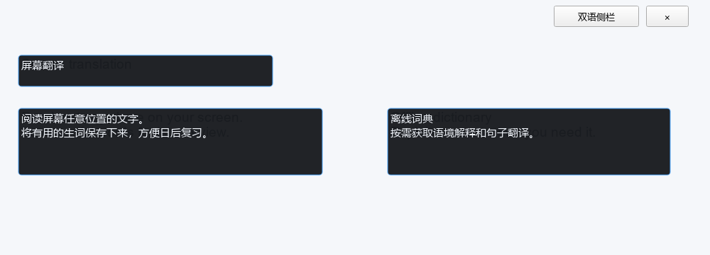
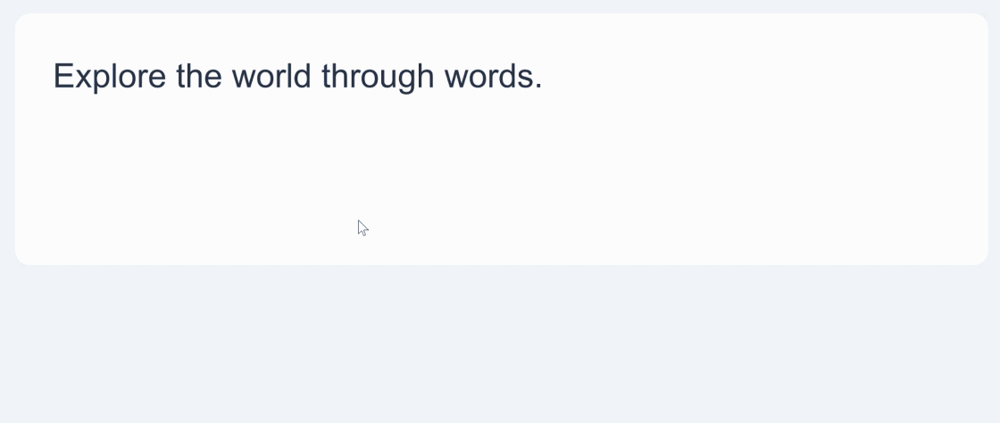
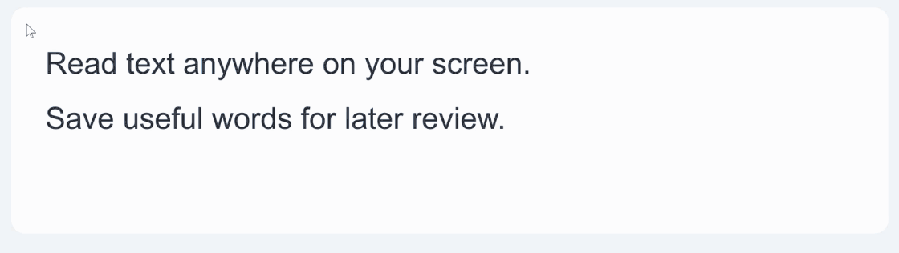
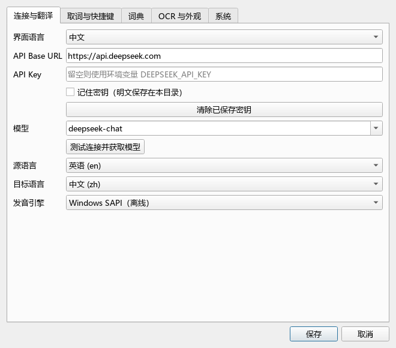
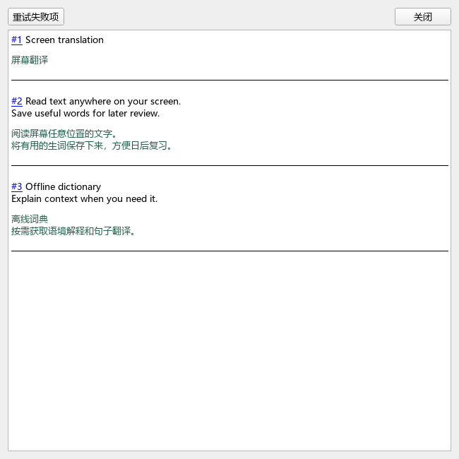
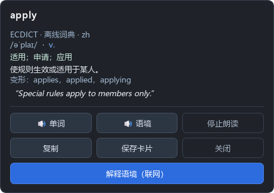

# ScreenGloss

[English](README.md) | **简体中文**

Windows 屏幕翻译、指针取词和词卡工具。OCR 与离线查词在本地完成，翻译和语境解释通过用户配置的 API 完成。



本仓库提供源码。首次运行前需安装依赖；词库及日韩俄 OCR 模型可另外添加。

## 功能

- 框选屏幕区域，本地 OCR 后分批翻译，支持译文覆盖与完整双语侧栏。
- 快捷键或鼠标停留取词，支持离线优先、模型优先、仅离线及仅模型模式。
- 按需解释单词在原句中的含义，获取句子翻译。
- 翻译剪贴板文本，保存、搜索、编辑词卡，导出 Anki TSV。
- Windows SAPI 离线朗读，可选 Edge-TTS 在线朗读。
- API 连接测试、自定义快捷键、OCR 参数、缓存管理与脱敏诊断。
- 系统托盘、可选桌面快捷方式与开机启动。

## 演示

点击动图预览可打开原始 MP4。两段视频分别展示模型词典和屏幕翻译，使用人工示例文本，不含音轨。

### 弹出词典 · Alt+D

指针定位 `world`，弹出模型释义，并按需解释语境。

[](docs/demos/dictionary.mp4)

[查看／下载原始视频（13 秒）](docs/demos/dictionary.mp4)

### 屏幕翻译 · Alt+S

框选两句英文，在原文位置附近显示中文译文。

[](docs/demos/screen.mp4)

[查看／下载原始视频（10 秒）](docs/demos/screen.mp4)

## 安装与运行

要求 Windows 10/11 x64、Python 3.11，建议至少 8 GB 内存。默认使用 CPU，无需 CUDA。

在仓库根目录打开 PowerShell：

```powershell
py -3.11 -m venv .venv
.\.venv\Scripts\python.exe -m pip install -r requirements.txt
.\.venv\Scripts\python.exe -B app\launcher.py
```

安装完成后可双击 `run.bat`；排障时运行 `run-console.bat`。程序常驻系统托盘，双击托盘图标打开设置，右键菜单可退出。

程序首次启动默认使用英文。在设置的第一个标签页中，可通过“Interface language（界面语言）”选择中文或其他语言，保存后应用。已有配置中的语言选择会保留，演示视频与截图展示的是中文界面。

若系统没有 `py` 命令，可用已安装的 Python 3.11 的 `python.exe` 完整路径执行 `-m venv .venv`。

`requirements.lock` 锁定核心依赖及其间接依赖，界面只安装所需的 Qt Essentials。本项目按目录运行。

### 离线资源

RapidOCR 安装包提供默认中英检测与识别模型。日韩俄识别模型、StarDict 和 JMdict 数据需另外准备；没有安装的资源不会因克隆仓库而自动出现。

资源放置位置和校验方式见 [资源说明](resources/README.zh-CN.md)。缺少词库时可使用模型词典；“仅离线”模式需要先安装词库。首次使用大型 StarDict 时会建立本地磁盘索引。

## 翻译 API



设置 → 连接与翻译，填写 Base URL、API Key 和模型。默认端点为 `https://api.deepseek.com`，支持 OpenAI Chat Completions 兼容接口，模型需支持完整的 JSON 输出。

“测试连接并获取模型”会检查所选模型的生成能力，并尝试获取模型列表。测试发送少量人工文本请求。

密钥可选择：

- **本次会话**：在设置中输入，不勾选“记住密钥”。
- **环境变量**：`DEEPSEEK_API_KEY`，也支持 `OPENAI_API_KEY`。
- **本地保存**：明确勾选后，以明文保存到被 Git 忽略的 `data/config.json`。

优先级为本次会话、已保存密钥、环境变量。普通设置保存不会把环境变量密钥写入文件。可参考 [配置示例](config.example.json)，示例不含凭证，程序不会自动读取该示例文件。

API 超时时间约束单次请求及其网络重试的总时长。长文本可能拆成多个请求；取消操作会停止本地等待，但已到达服务端的请求可能继续处理。

## 快捷键与翻译

| 快捷键 | 功能 |
|---|---|
| `Alt+S` | 冻结画面并框选翻译 |
| `Alt+D` | 查询指针处单词 |
| `Alt+T` | 翻译剪贴板 |
| `Alt+H` | 切换鼠标停留取词 |
| `Esc` | 关闭当前获得焦点的选择层、覆盖层、词典卡或侧栏 |

快捷键可在设置中修改。新操作替换旧任务；关闭覆盖层会取消当前屏幕翻译，迟到结果不会重新弹窗。译文过长、跨屏或布局冲突时，通过双语侧栏阅读完整内容；局部失败可重试失败项。



## 取词、词卡与朗读



OCR 提供字词坐标，程序在本地提取附近原句。“解释语境（联网）”由点击触发；仅离线模式不会请求模型。离线词典保留自身释义语言，不会因目标语言设置而自动翻译释义。

词卡可搜索、编辑、删除及导出选中或全部记录。同一单词、源/目标语言和原句重复保存时更新原卡，不同语境分别保留。Anki TSV 为 UTF-8，字段为 Front / Back / Tags，导入时启用 HTML；不生成图片、音频或 `.apkg`。

朗读默认使用 SAPI，语言覆盖取决于已安装的 Windows 声音。需要 Edge-TTS 在线朗读时，先安装可选依赖，再在设置中选择：

```powershell
.\.venv\Scripts\python.exe -m pip install -r requirements-tts.txt
```

Edge-TTS 会发送待朗读文字到在线服务；失败时尝试回退系统语音。

## 数据与隐私

- `data/` 在运行时创建，存放配置、词卡、缓存、词库、索引、日志及临时音频，整体由 Git 忽略。
- OCR 与离线查词不上传屏幕图像；模型功能发送相应文字到配置端点。
- 翻译缓存和词卡可能包含个人文字，不应上传或随发行包分发。
- 不含遥测和自动诊断上传。日志默认不记录密钥、屏幕正文、词条或完整服务响应。
- 调试截图默认关闭；显式开启后最多保留最近 10 张识别输入图像。保存失败不影响 OCR。
- 托盘“诊断与缓存”可检查资源、清理缓存、导出脱敏诊断；导出不会自动上传。
- 桌面快捷方式和开机启动由用户选择启用。移动目录后应重建已启用的快捷方式。

## 测试与限制

离线测试使用临时配置、数据库与人工文本，不读取个人词卡：

```powershell
.\.venv\Scripts\python.exe -B tools\run_checks.py
```

测试结果写入被忽略的 `tests/artifacts/`。静态检查可选使用 Ruff：

```powershell
.\.venv\Scripts\python.exe -m pip install -r requirements-dev.txt
.\.venv\Scripts\python.exe -m ruff check app tests tools
```

实际 API 连通性可在设置页测试。

主要面向水平桌面文字。密集文字与长行 OCR 可能耗时数秒；复杂竖排、低对比度、小字、游戏全屏、HDR 和受保护画面不保证识别。混合缩放多屏仍需更多实机验证。模型输出、自动语言判断和分词可能出错。

## 许可

原创代码采用 [MIT](LICENSE)，依赖与可选资源见 [第三方说明](THIRD-PARTY.zh-CN.md)。
